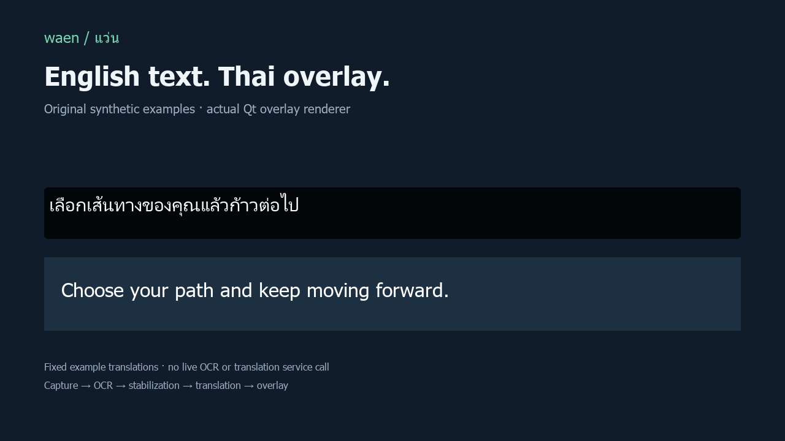

# waen · แว่น

[](https://github.com/Muegoo/waen/actions/workflows/ci.yml)

A **Windows game-text translation overlay**: select an English text region, recognize it with OCR, translate to Thai, and display the translation without covering the original text.



**Preview:** the image uses original synthetic English/Thai examples and the application's real Qt overlay renderer. It is a rendering demonstration, not live game capture, an OCR result, or a measured translation service response. [Animated renderer preview](docs/images/overlay-preview.gif).

## Engineering highlights

- Interchangeable Windows OCR and RapidOCR engines, with optional DirectML acceleration.
- Frame-change detection and temporal stabilization reduce repeated OCR/translation work.
- Geometry, grouping and placement keep the translated panels separate from source text.
- Glossary and optional corpus lookup precede the online translation backend.
- Separate capture, processing and UI layers, with deterministic tests using fake engines.

```text
Selected region → capture → frame difference / OCR / grouping
                               ↓ temporal stabilization
                         corpus / glossary / translation
                               ↓ layout and Qt overlay
```

## Run on Windows

Use Windows 10 version 2004+ or Windows 11. Python 3.12 is used for development/testing. Install an English Windows OCR language pack when using that engine.

```powershell
git clone https://github.com/Muegoo/waen.git
cd waen
py -3.12 -m venv .venv
.\.venv\Scripts\python -m pip install -e ".[dev]"
.\.venv\Scripts\python -m waen
```

Choose the game-text region, then start translation. Borderless Windowed mode is recommended for desktop capture. Google translation requires network access; glossary/corpus lookup can resolve matching text locally.

| Action | Default hotkey |
|---|---|
| Start / stop | Ctrl+Alt+T |
| Select region | Ctrl+Alt+R |
| Hide overlay | Ctrl+Alt+H |

Settings are stored at `%APPDATA%\waen\config.json`. This is a Windows application; cloning its source on a Mac does not provide macOS game capture support.

## Tests and evidence

```powershell
.\.venv\Scripts\python -m pytest -q
```

The portfolio audit on 19 October 2026 ran **327 passed, 10 skipped**. Skips concerned capture backends unavailable in the headless desktop session. CI runs the deterministic core suite; it does not certify in-game capture, DPI behavior or global hotkeys.

[OCR evaluation](docs/phase0-ocr-report.md) records the exact dataset and trade-offs. On one recorded dialogue-text subset, Windows OCR with `x3_binary` reached 96.4% word accuracy and 124 ms p95; this is not an accuracy claim for every game, speaker name or menu. See the report for RapidOCR/DirectML results and limitations.

## Windows builds

```powershell
.\.venv\Scripts\python -m pip install -e ".[build]"
.\.venv\Scripts\python -m PyInstaller build\waen.spec --clean
```

Copy the **entire** `dist\waen\` directory, not just the executable. The manual Windows package workflow produces a versioned release when explicitly dispatched. [Build notes](docs/phase5-build-notes.md) distinguish historical results from checks still pending.

## Current limitations

Manual checks remain for live-game hotkeys, DPI selection, a 30-minute soak, capture compatibility and a clean-machine packaged install. Translation quality and network-service availability vary. Some stylized text and menus remain outside the v0.1 target.

The source includes game-specific OCR evaluation fixtures and glossary examples. Their presence is not a license to redistribute the game, extracted dialogue archives or third-party game assets. Full extracted corpora are excluded from Git. The portfolio preview uses synthetic text instead.

- [Detailed development guide](docs/development-guide.md)
- [Design specification](docs/superpowers/specs/2026-09-10-waen-design.md)
- [Synthetic preview reproduction](docs/portfolio-preview.md)

No project-wide source license has been selected yet.
